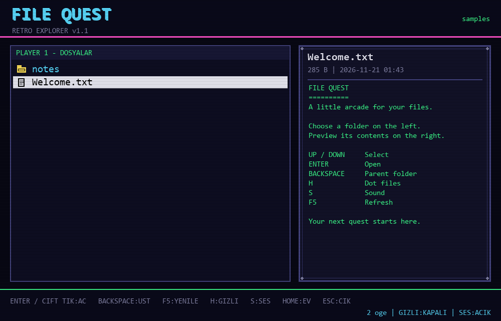

# File Quest

A compact retro file browser built with Python and Pygame. Neon panels, CRT scanlines and synthesized navigation sounds give local folders an arcade look.



## Run on Windows

Install Python 3.12 or newer, then run:

```powershell
python -m venv .venv
.venv\Scripts\python -m pip install -r requirements.txt
.venv\Scripts\python retro_file_explorer.py
```

After installing dependencies, double-click `Start.bat`. An optional folder can be passed on the command line:

```powershell
.venv\Scripts\python retro_file_explorer.py "C:\Your\Folder"
```

## Controls

- Up/down or mouse wheel over the list: select an entry.
- Enter or double-click: enter a folder or open a file in its associated application.
- Backspace: parent folder. Home: user home folder.
- F5: refresh. H: toggle dot-prefixed entries. S: toggle sound.
- Page Up/Down, left/right, or wheel over the preview: scroll text.
- Escape / Q: quit.

## Scope

Text previews read up to 64 KiB and display a limited number of lines. Images are shown as static previews; supported formats depend on the installed Pygame build. The window uses a fixed 1000 x 640 layout. H controls dot-prefixed names, not the Windows hidden attribute. Very large folders/images may take time to load.

The browser does not edit, move or delete files. Opening a file delegates to the operating system; scripts and executables may run through their associated application.

Windows is the primary target. macOS/Linux opening hooks exist but have not been tested.

## Development

```powershell
.venv\Scripts\python -m unittest discover -s tests -v
```

## Türkçe

Retro görünümlü yerel dosya gezgini. Metin/görsel önizlemesi, fare ve klavye kontrolü, açılıp kapatılabilen sesler içerir. Dosyaları değiştirmez veya silmez; Enter/çift tık dosyayı sistemin varsayılan uygulamasıyla açar. Kurulum için yukarıdaki komutları kullanabilirsiniz.
